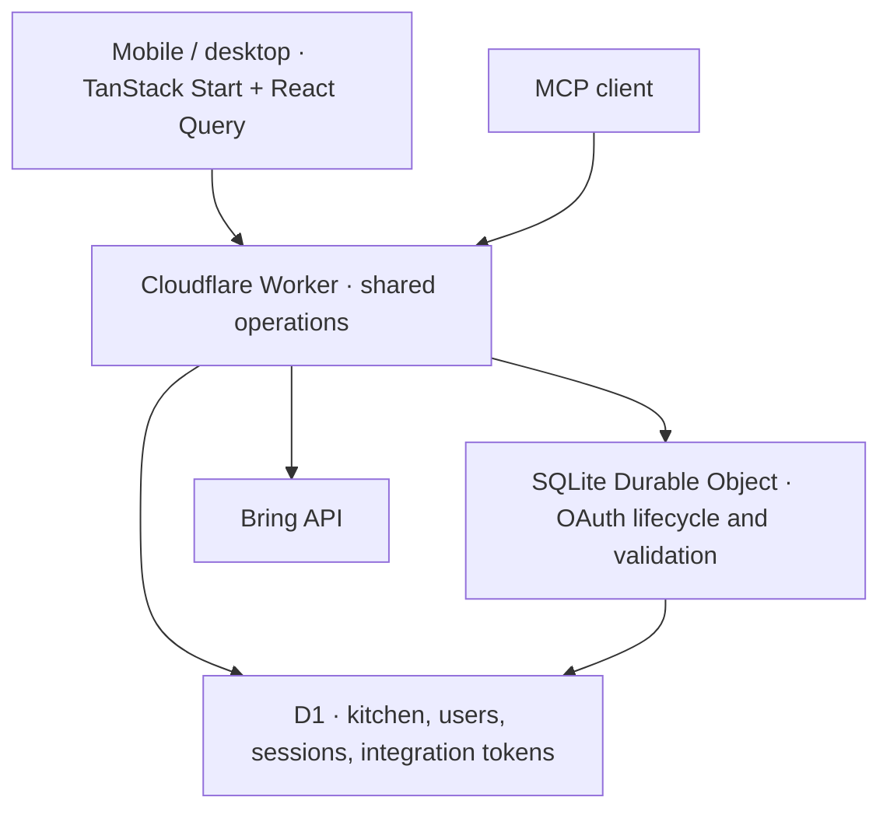

# LunchJu

A shared kitchen built for people and their agents. Plan meals, keep recipes, track pantry stock and food history, and manage groceries from a mobile-first website or an authenticated MCP client.

Live app: [lunchju.juli.sh](https://lunchju.juli.sh)

## What it does

- One home with multiple invited members. Everyone signs in with a passkey; there are no password accounts.
- Recipe creation, editing, favorites, serving scaling and pantry availability checks.
- Dated meal planning and an editable record of meals eaten. Ingredients are snapshotted so deleting a recipe preserves food history.
- Pantry lots with quantities, units, fridge/freezer/pantry storage and best-before dates.
- Shopping lists generated from planned meals. Compatible units are converted, stock is allocated once by meal date and expiry, and repeated generation does not add the same quantities again.
- Bring connection, list selection and explicit synchronization of shopping additions, changes, completions and removals.
- The same kitchen operations are available to the website and MCP agents, including the full catalog and dietary preferences.

## Architecture



TanStack Start renders the application through Cloudflare's Vite plugin. D1 holds the single home's data. A SQLite Durable Object supplies strongly consistent storage to Cloudflare's OAuth provider, following OpenWish's approach.

Only OAuth state changes and token validation pass through the Durable Object's queue. After validation, MCP tools execute in the outer Worker, so a slow Bring call does not hold up other users' authentication. Revocation blocks subsequent validations; already admitted requests can finish. There is no Workers KV binding and no runtime schema migration.

The Worker also serves static assets and runs daily cleanup of expired sessions, invitations, challenges and rate-limit records. Fonts are bundled with the application. There is no Supabase, external application server, or model API dependency.

## Local development

Use Node.js 24 or newer; the test database adapter uses `node:sqlite`.

```sh
npm ci
cp .dev.vars.example .dev.vars
# Set independent random BOOTSTRAP_TOKEN and ENCRYPTION_KEY values.
# Generate each with: openssl rand -hex 32
npm run db:migrate
npm run dev
```

Open [localhost:3000](http://localhost:3000). Keep `APP_ORIGIN=http://localhost:3000` in `.dev.vars`; the production origin remains in `wrangler.jsonc`. Local D1 and Durable Object state are separate from production.

On first launch, enter the deployment's `BOOTSTRAP_TOKEN` and create the owner's passkey. The token cannot enroll another owner after setup. The owner can invite more members from Settings. Invitations expire after 24 hours and can be used once. A member can be disabled without removing shared kitchen data.

Add a spare passkey in Settings before replacing your only device. Passkeys are tied to the site hostname: choose the final production hostname before registering users, or keep the existing hostname available while migrating accounts. There is no password or email recovery route.

## Deployment

The checked-in Wrangler configuration targets the `lunchju` Worker, the `lunchju.juli.sh` custom domain and its dedicated D1 database. Wrangler manages the domain's DNS record and TLS certificate. The `workers.dev` endpoint and preview URLs are disabled. For another Cloudflare account, create a D1 database and replace its ID, domain route and `APP_ORIGIN` in `wrangler.jsonc`.

```sh
npx wrangler login
npm run db:migrate:remote
npx wrangler secret put BOOTSTRAP_TOKEN
npx wrangler secret put ENCRYPTION_KEY
npx wrangler secret put BRING_API_KEY
npm run deploy
```

`ENCRYPTION_KEY` must be 32 random bytes encoded as 64 hexadecimal characters. Store it in your password manager: replacing it makes existing Bring tokens unreadable, requiring reconnection. `.dev.vars`, local runtime state and build output are ignored by Git. Production secrets must be installed with Wrangler; `.dev.vars` is only for local development.

Use a fixed HTTPS `APP_ORIGIN` matching the deployed site. OAuth metadata, redirect validation, CSRF checks and passkey verification use this value. `HOME_NAME` and `TIME_ZONE` are ordinary Wrangler variables. Set the time zone to an IANA identifier such as `Europe/Berlin`.

Health endpoint: `GET /api/health`. Do not delete or replace the OAuth Durable Object binding when redeploying; it stores registered clients and grants. Apply future D1 migrations deliberately before deploying code that requires them.

## Agent connection

Add this streamable HTTP MCP server to an OAuth-capable client:

```text
https://lunchju.juli.sh/mcp
```

The client discovers the authorization server, registers a client, and opens consent in your browser. Sign in with a LunchJu passkey, then choose permissions:

| Scope       | Capability                                                                                  |
| ----------- | ------------------------------------------------------------------------------------------- |
| `mcp:read`  | Catalog, recipes, ingredient checks and permitted account information                       |
| `mcp:write` | Add/edit recipes and stock, plan/log meals, groceries, preferences and explicit Bring sync  |
| `mcp:admin` | Delete items and manage integrations or accounts where the signed-in user's role permits it |

Read access is required. Access tokens last 15 minutes. Check **Keep connected until I revoke access** for renewable agent access; it is off by default. Refresh tokens use the provider's rotation and retry handling. Review and revoke grants at `/oauth/grants`, also linked from Settings. Disabling a member blocks their sessions and future OAuth token validation.

The MCP resource `lunchju://catalog` and `get_catalog` tool return the complete recipe, pantry, meal, grocery and preferences catalog. Tool names and JSON schemas are registered from `src/server/operations.ts`; UI requests call that same implementation. Deletion and integration administration require explicit admin scope. Owner-only checks still apply to an agent acting for a member.

Example requests:

- “Read our pantry and preferences, add three vegetarian recipes, and plan dinners for next week.”
- “Check whether we have enough ingredients for four servings of tomato pasta.”
- “Generate groceries for this week's plan, then sync them to Bring.”

An optional `AGENT_API_KEY` Worker secret provides full owner access for a trusted client that cannot use OAuth. It is disabled unless explicitly configured. Prefer OAuth for per-client consent and revocation.

## Bring

The native Worker client ports the HTTP protocol from the local `bring-cli` implementation. Set `BRING_API_KEY` to that client's application key as a Worker secret. Then the home owner connects their Bring email/password in Settings and selects one shopping list. LunchJu sends the password to Bring for login and never persists it. Access and refresh tokens are stored with AES-GCM authenticated encryption in D1.

Press **Sync** in Groceries or Settings, or call `bring_sync`. A database lease prevents overlapping integration operations. Stable item IDs and queued removals allow retries without generating new remote IDs. Bring failures leave local groceries saved and report a sanitized error.

Locally edited items take precedence during a sync. New remote items and remote completions are imported. Bring's free-text quantity descriptions are preserved in notes; imported items start as one piece because a description cannot reliably be converted to a numeric quantity. Selecting another list resets remote links and sends currently open local groceries to the new list on the next sync. Synchronization is explicit, without background polling.

## Food quantities and history

Ingredient names match after Unicode, case and whitespace normalization. There is no fuzzy synonym matching. Mass and volume are separate; the app never guesses a food's density. A cup is defined as 240 ml, a tablespoon as 15 ml, and a teaspoon as 5 ml.

Meal-plan generation uses the earliest-expiring usable stock first and excludes stock that expires before the meal date. Existing shopping-list quantities are treated as a minimum: generation does not remove manually requested extras or automatically shrink old entries after a plan changes.

Marking a meal eaten does not automatically consume pantry stock. Checking a grocery does not automatically create pantry stock. Update stock explicitly through the UI or agent, so uncertain serving sizes and purchase amounts do not silently corrupt inventory. Food history records meals and servings; nutrition or calorie calculation is not included.

## Verification

```sh
npm test
npm run typecheck
npm run build
```

Tests run the production SQL against SQLite and exercise signed WebAuthn registration/login, challenge replay protection, invitation claims, session revocation, permission checks, meal snapshots, quantity allocation, grocery generation, encrypted Bring tokens and mocked Bring synchronization. OAuth tests cover PKCE consent, code exchange/reuse, persistent refresh across object restart, CSRF and revocation.

Physical-device passkey UX and a real Bring account connection require a user's browser and account. Protocol tests do not substitute for those final checks.

Implementation references: [Cloudflare TanStack Start](https://developers.cloudflare.com/workers/framework-guides/web-apps/tanstack-start/), [Cloudflare MCP authorization](https://developers.cloudflare.com/agents/model-context-protocol/protocol/authorization/), and [SimpleWebAuthn server](https://simplewebauthn.dev/docs/packages/server).

See `THIRD_PARTY_NOTICES.md` for the OpenWish and Bring client source notices.
